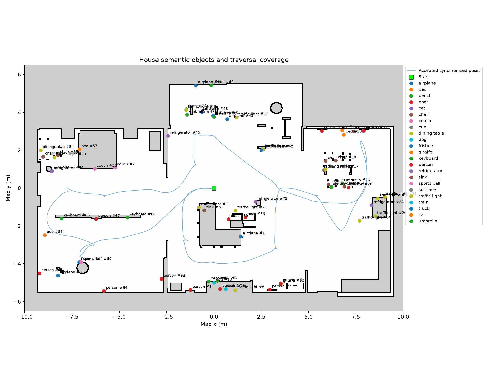
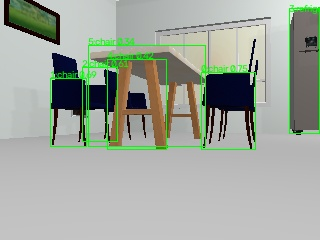
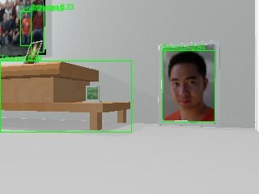
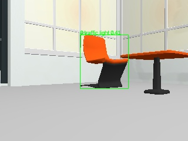
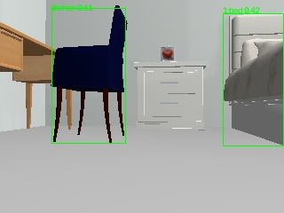
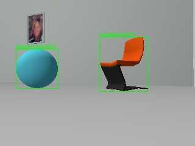
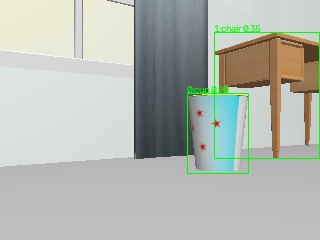

# DS685: RGB-D Object Detection and Semantic Memory

Rohan Shanbhag | Recorded experiment: 12 October 2026 | Run: house03

## Experiment and scope

An independent Python detector subscribes to raw ROS CDR messages over Zenoh, synchronizes RGB/depth/odometry, runs YOLOv8n and CLIP, estimates map coordinates, and stores fused objects plus immutable observation evidence in PostgreSQL/pgvector. The house traversal completed all 17 navigation goals. It recorded 225 keyframes, 204 valid-depth observations, and 72 semantic objects over 660.8 seconds of detector wall time. The first-to-last keyframe interval was 205.602 seconds in simulation time; the synchronized route was approximately 60.74 m long.

The detector successfully implements the pipeline, but its semantic map has many errors. Under the reviewed instance-matching protocol below, 9 of 20 inventory objects were recovered: precision 12.5% across all 72 stored records and recall 45.0%. These are measured outcomes of this run, not expected performance claims.

The run used simulator world-pose localization as a controlled baseline. A separate ROS helper computes T_map_odom = T_map_base_truth * inverse(T_odom_base) from Gazebo world pose and wheel odometry; AMCL's competing transform broadcaster was disabled. This isolates much of the localization error from perception and association. It is not an evaluation of SLAM or real-world localization. An earlier AMCL diagnostic run developed substantial pose inconsistency and is excluded from the reported metrics. The helper does not provide object locations to the detector; SDF object poses are used only afterward for evaluation.

## Independent implementation and reference analysis

The reference detector demonstrates Zenoh image subscription, YOLO inference, CLIP crops, and keyframe gating. Its latest-pose callback does not implement nearest-stamp RGB-D synchronization; its covariance declarations use variable-length lists, although ROS Odometry carries fixed arrays of 36 doubles. Its ingest worker stores detections rather than implementing the required fused object/evidence relationship. The submitted package supplies its own runtime, wire types, synchronizer, geometry, association, database layer, and evaluation. The existing course pipeline is not the assignment implementation.

The detector runtime imports no ROS Python packages. pycdr2 definitions cover Image, Odometry, and TFMessage, including the nested ROS types and fixed covariance arrays. An independent fixture serialized with ROS itself verifies the Odometry decoder, beyond a self-serialization round trip. The Image decoder handles row stride, byte order, RGB/BGR conversion, and float32 depth.

Color input is limited to at most 10 Hz in ROS timestamp time; the simulated sensor delivered approximately 5 Hz. Bounded, timestamp-sorted buffers select the nearest depth and odometry messages within 200 ms. Pending color frames wait briefly for messages to arrive. Missing synchronization or a missing map transform rejects the frame. Valid map poses trigger inference after translation of at least 0.5 m OR wrapped yaw change of at least 15 degrees from the previous accepted keyframe. The first synchronized pose is accepted; 838 subsequent frames were rejected by motion gating.

YOLOv8n uses its pretrained COCO labels at confidence >= 0.3. Detection crops are converted from OpenCV BGR to RGB, preprocessed, and passed to CLIP ViT-B-32 / laion2b_s34b_b79k as one batch per keyframe. The resulting 512-dimensional float32 embeddings are L2-normalized. The runtime records both accepted and depth-rejected detections, so depth rejection does not artificially reduce the raw detector's visibility-based detection rate. It also publishes its evidence envelope to tb/detections.

## RGB-D localization and numerical verification

Depth is the median of finite, positive samples in the central half-width and half-height of each bounding box: a 25% margin is removed from each edge. At least five valid pixels are required. The bounding-box center (u,v) and median optical-axis depth d give p_optical = ((u-160)d/277.13, (v-120)d/277.13, d). The camera is 320 by 240 pixels, with fx=fy=277.13 and principal point (160,120).

The optical-to-body rotation is [[0,0,1],[-1,0,0],[0,-1,0]], and the camera translation in the robot body is (0.064,-0.065,0.094) m. The chain is p_map = T_map_base * T_base_camera_body * R_body_optical * p_optical. T_map_base is composed from synchronized odometry and T_map_odom, not obtained by subtracting frame translations. Planar robot roll/pitch and base z are assumed zero. The camera translation follows the assignment calibration; the Gazebo sensor's own SDF pose differs slightly, so centimeter-scale systematic calibration error remains possible.

A hand-computed off-center case uses u=150, v=90, d=2, and robot pose (1,2,0):

- Optical point: (-20/277.13, -60/277.13, 2).
- Rotated body point: (2, 20/277.13, 60/277.13).
- Add camera translation: (2.064, 0.007168296467362, 0.310504889402086).
- Add robot translation: (3.064, 2.007168296467362, 0.310504889402086).

The unit test asserts these constants at absolute tolerance 1e-9 and zero relative tolerance. A second independent case rotates the map-to-odom transform by pi/2 and expects (9.992831703532638, 23.064, 0.310504889402086). Missing map transforms are tested as errors.

For all 225 recorded keyframes, RGB-depth timestamp separation was 0 ms and RGB-odometry separation was at most 18 ms. Comparison with the simulator pose log gave median XY error 0 m and 95th percentile 0.01656 m. This measures residual timestamp/transform error under the simulator baseline, not AMCL accuracy. Every fused embedding was unit length within 1e-5; exported observation counts and foreign keys agreed.

## Persistence and association

`sql/semantic_schema.sql` defines semantic_objects with class, fused XYZ, observation_count, mean_embedding vector(512), and first/last ROS nanosecond timestamps. object_observations stores the corresponding object ID, ROS timestamp, robot map pose, camera map position/quaternion, bearing, range, bounding box, confidence, and original embedding. Camera orientation uses the camera body axes; the optical rotation is explicit in geometry. Bearing is relative to the robot heading, zero forward and positive left, wrapped to [-pi,pi]. Range is horizontal robot-to-object distance in meters, not optical depth or full 3D range.

Association first filters by identical class and 3D Euclidean distance <= 0.5 m. No candidate creates an object; one candidate merges; multiple candidates choose the maximum cosine similarity to the normalized object prototype. Equal scores retain object-ID order. Position uses a count-weighted running average. The embedding prototype uses a count-weighted update followed by normalization. This normalized recurrence is order-dependent and is not exactly a normalized sum of all original vectors; those originals are preserved for later alternatives. Count and first/last timestamps update with every accepted detection.

Object association and evidence insertion occur in one transaction. A table lock serializes writers to prevent concurrent duplicate creation; this is appropriate for this small experiment but limits throughput. Exceptions roll back both changes. Each run uses an explicit schema (here ds685_house03), and tests use disposable UUID schemas. CSV exports use one repeatable-read snapshot.

The four parameterized queries return the nearest object of a requested class to XY, all objects in a rectangular XY region, a histogram of fused objects by class, and time-ordered evidence for a selected object. `results/house03/queries.json` saves actual outputs for chair nearest (5,-1), region x=[5,9], y=[-4,3], the full histogram, and all observations of that nearest chair.

## Coverage, ground truth, and scoring protocol

The route visits the central hall, living room from multiple sides, kitchen and dining area, northern chairs, western bedroom, southwest ball/chair area, and returns to the origin. All 17 navigation outcomes are recorded as SUCCEEDED. The map below shows every stored prediction, including incorrect classes, and the actual synchronized traversal. Some labels overlap in dense regions; the CSV identifies every object precisely.

The checked-in world contains 87 named included models, rather than the nominal count in the assignment narrative. `ground_truth.csv` records every model, SDF origin, orientation, asset URI, and explicit semantic mapping. The evaluated inventory has 20 physical instances: 8 chairs, 4 tables (kitchen, coffee, balcony, and reading desk grouped as COCO dining table), 2 sports balls, 2 televisions, 1 bed, 1 couch, 1 refrigerator, and 1 vase. Images of people or landscapes do not count as physical people or televisions. A tablet is not counted as a laptop. Composite kitchen/tableware subparts are not independently annotated; these counts describe the explicit model-instance inventory, not an exhaustive segmentation of every component mesh.

All 225 saved frames were reviewed with AI assistance using the annotated RGB contact sheets and adjacent views. Visible classes include partial physical objects. SDF locations and projected center ordering help distinguish similar dining chairs. A detection receives a physical instance ID only when its class and visible object agree; photographs, incorrect classes, and unresolved multi-object boxes receive null. The editable annotation transcription and its JSON output are included. There is no independent human double annotation; dense chair identities and small partial views are a source of uncertainty.

A stored record is eligible for a correct match if its reviewed observations identify exactly one physical instance and its fused XY position is within 1.0 m of that instance's SDF origin. This tolerance accounts for surface-versus-origin offsets of large furniture. Each true instance counts at most once, so extra records of the same instance are false positives. Records combining multiple identified instances count as false merges. Unmatched observations do not establish an additional identity; this makes the false-merge count a lower bound.

Per-class precision is one-to-one correct matches / stored records; recall is correct matches / true inventory instances. The assignment's duplicate-rate ratio is stored records / true instances: values above one can reflect both duplicates and false positives, while values below one can reflect misses or merges. Detection rate is relevant keyframes with at least one correct-class physical detection / reviewed keyframes in which that class is visible, including detections whose depth was rejected. N/A means a zero denominator; it is not zero performance. The vase was not identifiable in the saved camera views, so its detection rate is N/A while its inventory recall is zero.

## Measured results

| Class | True | Stored | Correct | Precision | Recall | Stored/true | Detection rate |
|---|---:|---:|---:|---:|---:|---:|---:|
| bed | 1 | 3 | 1 | 33.3% | 100.0% | 3.000 | 5.9% |
| chair | 8 | 9 | 4 | 44.4% | 50.0% | 1.125 | 18.3% |
| couch | 1 | 2 | 0 | 0.0% | 0.0% | 2.000 | 0.0% |
| dining table | 4 | 2 | 2 | 100.0% | 50.0% | 0.500 | 8.9% |
| refrigerator | 1 | 4 | 1 | 25.0% | 100.0% | 4.000 | 21.4% |
| sports ball | 2 | 2 | 1 | 50.0% | 50.0% | 1.000 | 19.6% |
| tv | 2 | 1 | 0 | 0.0% | 0.0% | 0.500 | 0.0% |
| vase | 1 | 0 | 0 | N/A | 0.0% | 0.000 | N/A |

The other stored classes have no matched inventory instances. Their precision is zero; recall, stored/true, and visibility-based detection rate are undefined for the scoped inventory. Their actual predictions were reviewed as incorrect physical-object detections, including the sink prediction on the living-room furniture. Counts: airplane 6, bench 5, boat 2, cat 1, cup 1, dog 1, frisbee 1, giraffe 1, keyboard 2, person 11, sink 1, suitcase 1, traffic light 11, train 1, truck 1, umbrella 3.

Two chair records are confirmed false merges: object #13 combines ChairA_01_002 and ChairA_01_004; #16 combines ChairA_01_003 and ChairA_01_004. Eleven of the 20 inventory instances have no valid one-to-one match. All three orange ChairD models are missed as chairs; the couch, both televisions, northern ball, balcony/coffee tables, and vase also contribute misses. A duplicate or wrong-class record near a real object does not count as recovery.

## Association radius and measured uncertainty

The recorded radius was 0.5 m. This covers the measured 95th-percentile same-instance pair distances of 0.258 m for ChairA_01_001, 0.436 m for ChairA_01_002, 0.451 m for the bedroom chair, 0.458 m for the refrigerator, and 0.357 m for the southwest ball. Typical central-ROI depth MAD was 0.011-0.065 m for these objects; the reading desk and kitchen table were larger at 0.177 and 0.245 m. ROI MAD includes surface geometry, so it is not a calibrated sensor-noise estimate. Across-view depth standard deviation includes the robot approaching the object and must not be interpreted as sensor noise.

Bounding-box size changes were substantial: ChairA_01_002 width/height standard deviations were 18.95/18.66 pixels, and the ball was 40.23/40.40 pixels across viewpoints. At 3 m depth, a 10-pixel center displacement corresponds to about 0.108 m lateral shift. A4 and A3 had much larger pair-distance outliers (1.214 and 2.358 m), consistent with overlapping chairs and central-box depth reaching a different surface. The 1.7 cm pose residual is much smaller than these perception errors in this controlled run.

Replaying the identical accepted observations with different radii gives the following results. The nearest-position baseline changes only the choice among multiple same-class radius candidates. It still uses the same confidence, geometry, running updates, and evidence.

| Radius (m) | Tie breaker | Stored records | Correct instances | Precision | Recall | Chair records | False merges |
|---:|---|---:|---:|---:|---:|---:|---:|
| 0.25 | clip | 84 | 10 | 11.9% | 50.0% | 15 | 1 |
| 0.25 | nearest_position | 84 | 10 | 11.9% | 50.0% | 15 | 1 |
| 0.5 | clip | 72 | 9 | 12.5% | 45.0% | 9 | 2 |
| 0.5 | nearest_position | 71 | 9 | 12.7% | 45.0% | 8 | 2 |
| 0.75 | clip | 65 | 8 | 12.3% | 40.0% | 7 | 2 |
| 0.75 | nearest_position | 65 | 8 | 12.3% | 40.0% | 7 | 2 |
| 1.0 | clip | 61 | 7 | 11.5% | 35.0% | 6 | 3 |
| 1.0 | nearest_position | 61 | 8 | 13.1% | 40.0% | 6 | 2 |

The 0.5 m radius reduces record proliferation relative to 0.25 m, but loses one recovered instance and increases confirmed false merges. Increasing to 1.0 m makes merging worse. CLIP does not consistently outperform spatial selection here: at 0.5 m it adds one record without increasing recovery; at 1.0 m it performs worse. Repeated visually identical chairs are a difficult identity cue. Thus 0.5 m is a measured compromise, not a proven optimum, and 0.25 m is preferable if preserving instance recall matters more than duplicate reduction. Radius selection was explored on this same run, not on a held-out validation set.

## Screenshots and failure analysis

These are actual annotated images captured from the simulated camera; labels are the detector output, including mistakes. The complete RGB and annotated frame set and all ten contact sheets are included in results/house03/. The screenshots below are selected evidence, not synthetic illustrations.

Keyframe 65: multiple similar dining chairs overlap. Duplicate boxes and background depth explain why radius association can confuse identities even with accurate robot pose.

Keyframe 27: photographs produce person predictions and the TV cabinet is called a bench. The visible physical television is not correctly labeled. Picture content must not be treated as a separate person in the world inventory.

Keyframe 128: an orange chair is classified as a traffic light. This class error cannot be repaired by same-class association or CLIP tie-breaking.

Keyframe 174: the bedroom chair and a partial bed are correctly recognized. Many earlier views called this same bed a couch, explaining low bed detection rate despite recovering one bed instance.

Keyframe 185: the blue exercise ball is correctly recognized while the neighboring chair is called an airplane. In northern views the dumbbell weights, rather than the blue ball, were labeled sports ball.

Keyframe 171: the trash bin resembles a cup and is repeatedly detected as one. Repetition makes a stable false object in memory; observation count alone does not establish correctness.

The main failure is domain mismatch between pretrained COCO imagery and these low-resolution, stylized assets seen from a low robot camera. Large objects are often truncated; farther furniture exceeds the approximately 5 m valid-depth range; central box depth may hit a rear surface through chair legs. A median protects against isolated depth outliers but not an ROI dominated by the wrong object. Broad traversal does not guarantee every object is visible: the vase remained outside identifiable views.

Promising improvements would be simulation-specific training or augmentation, more varied camera viewpoints, depth clustering/segmentation inside each box, temporal geometric consistency checks, and multi-hypothesis association for identical chairs. These are proposals, not evaluated improvements. The submitted run retains confidence 0.3 and the prescribed pretrained models so the measured baseline remains reproducible.

## Verification and reproducibility

All 25 automated tests passed, including the hand-computed transforms, rotated map/odom composition, fixed-array ROS wire fixture, timestamp rejection and out-of-order selection, image stride handling, stationary gating, CLIP batch/normalization, multi-candidate cosine selection, database transaction rollback, and metric definitions. Integration tests exercised PostgreSQL/pgvector in isolated schemas. The recorded export passed count, foreign-key, normalization, and synchronization audits. Actual package versions and the YOLO weight SHA-256 are in environment.json.

The README provides build, capture, query, export, and replay commands. Runtime observations use ROS nanoseconds; report wall durations and ROS durations are explicitly separated. Capture time and simulation physics are not deterministic, so a new run need not have identical frame counts. The archived embeddings and annotations permit exact association/metric replay without rerunning neural inference. depth_frames.npz retains the original depth arrays for the noise analysis. Ground-truth localization makes these results a perception baseline and should be replaced by a separately evaluated localization system before claiming real-world performance.

The implementation, visual annotation, and report were prepared with AI assistance. The frame evidence and annotation records are included to make that assistance reviewable; the visual labels have not been independently double-checked by a human.

## Sources

- [Assignment specification](https://aegean.ai/aiml-common/assignments/topics/ROS/object-detection).
- Course reference source: detector/object_detector.py, detector/embedding_ingest.py, tb_worlds/worlds/house_world.sdf.xacro, and the included residential model assets.
- [Gazebo OdometryPublisher documentation](https://gazebosim.org/api/sim/9/classgz_1_1sim_1_1systems_1_1OdometryPublisher.html) and [Harmonic implementation](https://github.com/gazebosim/gz-sim/blob/gz-sim8/src/systems/odometry_publisher/OdometryPublisher.cc) describe the simulator world-pose publisher used by the localization baseline.
- [ROS Odometry message](https://docs.ros.org/en/jazzy/p/nav_msgs/msg/Odometry.html) defines the pose and twist reference frames; the fixture checks the actual ROS serialization.
