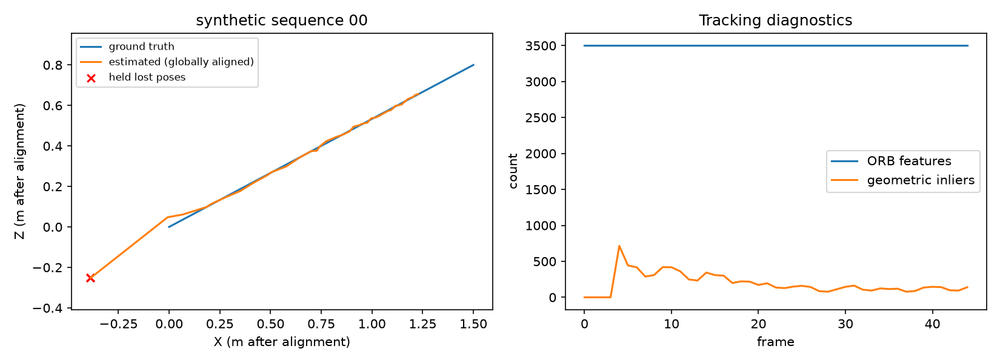
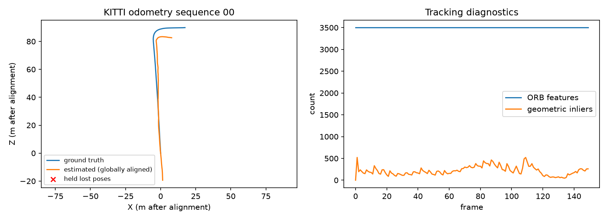
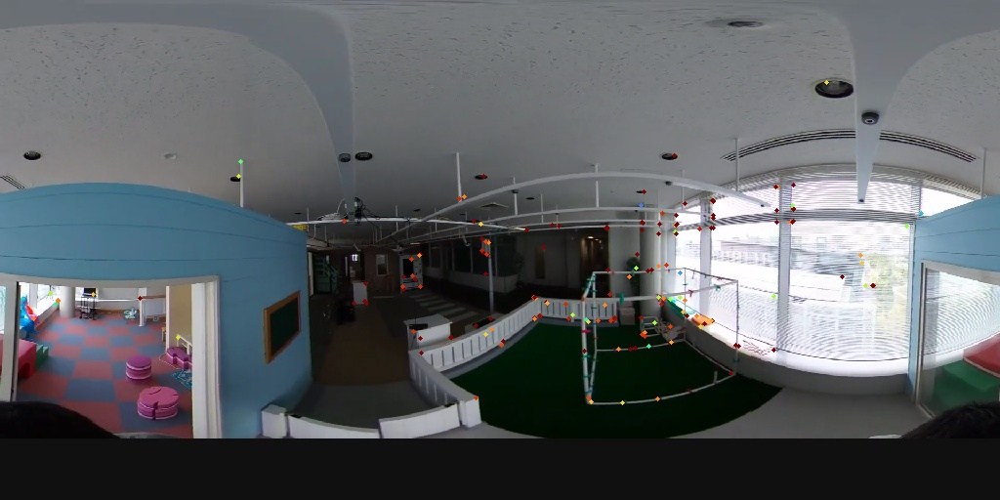
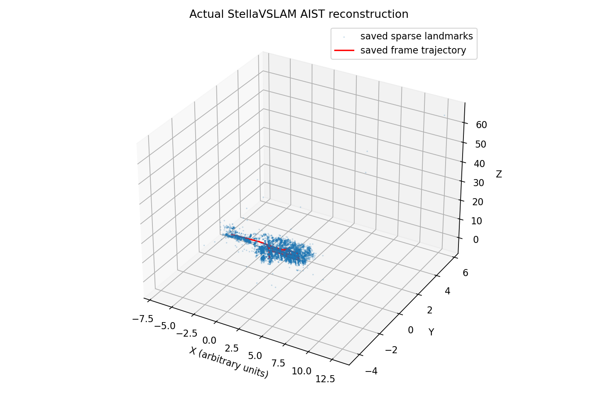

# DS685 Robotics: Visual SLAM and navigation

The DS685 [Visual SLAM assignment](https://aegean.ai/aiml-common/projects/robotics/visual-slam/visual-slam) covers monocular odometry, indoor reconstruction, and visual localization for robot navigation.

The project implements a Python monocular visual-odometry pipeline, a calibrated perspective-camera workflow, pinned official StellaVSLAM applications, and an RGB-D StellaVSLAM/Nav2 integration.

## Execution status and evidence

| Component | Status | Evidence |
|---|---|---|
| ORB, essential geometry, triangulation, PnP, KITTI loaders, Sim(3)/SE(3), ATE/RPE | Implemented and tested | [tests](tests/), [test log](results/validation/pytest.log) |
| Rendered monocular experiment | Executed; explicitly synthetic | [metrics](results/synthetic/metrics.json), [X–Z comparison](results/synthetic/trajectory_xz.png) |
| Official KITTI acquisition/evaluation | Executed on 150 official sequence-00 frames | [metrics](results/kitti-00/metrics.json), [acquisition provenance](results/validation/kitti-acquisition.json) |
| Headless ROS/Gazebo baseline | Executed with real simulated sensors | [smoke report](results/ros2/headless-baseline/smoke.json), [RGB](results/ros2/headless-baseline/camera.png), [depth](results/ros2/headless-baseline/depth.png) |
| StellaVSLAM reference | Executed successfully; map, trajectories and tracking frames saved | [summary](results/stella/aist/summary.json), [reconstruction](results/stella/aist/reconstruction.png), [tracking](results/stella/aist/tracking_900.jpg) |
| Personal calibration and reconstruction | Calibrated with 23 checkerboard views. StellaVSLAM recovered 543 camera poses and 1,531 landmarks. | [Task 2 YouTube demo](https://youtu.be/vi-8dxjenc0) |
| ROS wrapper, TF bridge, occupancy insertion, Nav2 launch | Hosted simulation maintained visual tracking and reached a 0.5 m goal without a prior map. | [hosted run](https://github.com/RonShan03/turtlebot-maze/actions/runs/45091811727), [integration tutorial](task3_ros2_nav2/TUTORIAL.md) |
| Task 3 navigation demo | First Nav2 action succeeded. The second attempt timed out. | [Demo video](results/ros2/demo/task3-demo.mp4), [recording measurements](results/ros2/demo/recording.json) |

## Install and run

Commands below start in `assignments/assignment-3` unless a command explicitly changes directory. Python 3.10+ is supported by the source; the recorded Windows test runtime is Python 3.14. An Ubuntu Python 3.12 CI workflow is also provided. ROS uses the distribution's system Python, never a Windows virtual environment.

```powershell
python -m venv .venv
.venv\Scripts\python -m pip install -e ".[test,download]"
.venv\Scripts\python -m pytest -q
.venv\Scripts\python -m task1_python_vslam.cli --help
.venv\Scripts\python -m task2_stella_vslam.camera --help
```

On Linux use `.venv/bin/python` or activate the environment. The measured Windows dependency snapshot is [python-windows-lock.txt](results/validation/python-windows-lock.txt). `pyproject.toml` documents compatible version ranges; ROS/Gazebo packages are installed from ROS Jazzy/Ubuntu 24.04 apt repositories. Full container image identities should be preserved alongside each experiment because apt tags can advance.

For a reproducible synthetic image experiment (use new output directories for every run):

```bash
python -m task1_python_vslam.cli synthetic --frames 45 --output data/synthetic-new
python -m task1_python_vslam.cli run --root data/synthetic-new --output results/synthetic-new --config task1_python_vslam/configs/default.yaml
```

For official KITTI sequence 00, download only a prefix using ZIP range reads:

```bash
python -m task1_python_vslam.acquire_kitti --remote --sequence 00 --frames 150 --output data/kitti-new
python -m task1_python_vslam.cli run --root data/kitti-new --sequence 00 --max-frames 150 --output results/kitti-00-new
```

If the official server refuses ranges or requires registration, obtain the grayscale and pose ZIPs from the [official odometry page](https://www.cvlibs.net/datasets/kitti/eval_odometry.php?benchmark=odometry), then use `--images-zip PATH --poses-zip PATH` instead of `--remote`. This extracts only `image_0`, calibration, times and ground truth for the selected prefix. Large data remain ignored. Do not present synthetic images as KITTI. Evaluation uses training sequence ground truth locally; this student project is not a KITTI leaderboard submission.

## Task 1: geometry, mapping and evaluation

`geometry.py` uses **camera-to-world** poses `T_wc`, optical axes X right, Y down, Z forward, and column-vector transforms. OpenCV PnP returns the opposite world-to-camera transform; the implementation inverts it. The projection is

\[
\lambda [u,v,1]^T = K [R_{cw}\;t_{cw}] [X_w,Y_w,Z_w,1]^T.
\]

ORB supplies rotation-tolerant binary descriptors. Hamming KNN matches pass a ratio test and mutual nearest-neighbour check. `findEssentialMat` receives calibrated normalized points; its RANSAC threshold is converted from pixels using the focal lengths. The essential relation is

\[
x_2^T E x_1=0,\qquad E=[t]_{\times}R.
\]

`recoverPose` chooses a relative camera transform using positive-depth cheirality. Its translation has unit norm, without metric scale. Composition is therefore `T_w2 = T_w1 @ inverse(T_21)`, with a unit initialization baseline. No ground truth enters `VisualOdometry`.

Landmarks are triangulated with `K @ inverse(T_wc)[:3]`. Homogeneous division rejects near-zero denominators; positive depth in both cameras, at least 0.5° parallax, and at most 2.5 pixels reprojection error filter the reconstructed points. Invalid points are never carried into PnP. Keyframes maintain a small local landmark map. PnP-RANSAC plus LM refinement estimates absolute poses in this map's existing arbitrary scale. New landmarks use a keyframe baseline. Old keyframes are culled from the local tracking window.

When landmark tracking fails, two-view recovery can reuse the last successful translation-step magnitude; that fallback is explicitly recorded and can drift badly during changing speed. Too few matches, insufficient parallax or failed cheirality produce a **lost** row and a held trajectory pose. The previous good reference remains available for recovery; there is no silent gauge reset or invented motion. Initial low-baseline frames can be lost before initialization. This is educational local visual odometry with a sparse map: it lacks place recognition, loop closure, robust global relocalization, global bundle adjustment, and a production map lifecycle.

KITTI `P0` supplies the rectified grayscale camera matrix. Image filenames must form a prefix starting at zero; timestamps must be finite and strictly increasing. Ground-truth rows are 3×4 `T_wc`. Extrinsics from `P1/P2/P3` are unnecessary because the pipeline uses only left grayscale `image_0`.

Evaluation estimates **one global** Umeyama similarity from valid corresponding camera centers:

\[
\underset{s,R,t}{\arg\min}\sum_i\|p_i^{GT}-(sRp_i^{est}+t)\|^2.
\]

`--alignment sim3` fits scale, rotation and translation; `se3` fixes scale to one and is meaningful for metric estimates. ATE is translation RMSE after that global alignment. RPE uses `inverse(inverse(Tgt_i) @ Tgt_j) @ (inverse(Test_i) @ Test_j)` at a configured frame delta, with translation norm and rotation angle. Sim(3) also rotates estimated camera orientations; it does not scale rotation. Intervals spanning any lost frame are excluded from RPE. Both valid-only ATE and all-frame ATE including held poses are reported. A rank field exposes degenerate position-alignment geometry. These are ATE/RPE measures, **not** KITTI's 100–800 m segment leaderboard metric.

The saved synthetic run has 45 frames: 42 valid/anchor poses, 3 failed initialization frames and 40 PnP frames. Its globally aligned valid-pose ATE is **0.16049 m**, all-frame ATE **0.21932 m**, one-frame RPE translation **0.03118 m**, and RPE rotation **0.18541°**. These are measurements on rendered billboards, not evidence of real-world accuracy. See the JSON for scale and diagnostics.



The CLI also writes a 3D trajectory plot, triangulated-landmark plot/XYZ file, representative ORB match images, original and aligned KITTI-format poses, timestamps and one CSV diagnostics row per image. PnP's inlier ratio counts accepted map observations over all descriptor matches, so it is not a pure essential-matrix RANSAC success rate. Runtime is measured on the executing machine and should not be compared across hardware without controlling the environment.

The **real KITTI sequence 00 prefix** contains frames 000000–000149 (14.9 s at the supplied timestamps). All 150 rows are valid/anchor; one essential initialization is followed by 148 PnP poses. Measured valid/all-frame ATE is **7.51216 m**, median ATE **6.26455 m**, one-frame RPE translation **0.50522 m**, and rotation **0.19584°** after one global Sim(3) with scale **2.48481**. Mean ORB count is 3,500, mean geometric inlier ratio 0.13611, and measured tracking time 40.74 s. These results demonstrate execution but also substantial scale drift: absence of a declared tracking failure is not proof of accurate localization. The prefix is too short for broad sequence-level conclusions. No per-frame ground-truth scale correction is used.



## Task 2: official StellaVSLAM and personal video

The pinned upstream versions are:

| Repository | Revision |
|---|---|
| `stella-cv/stella_vslam` | `e445b5452535e781fdf6777ec33a06f5f8f5e416` |
| `stella-cv/stella_vslam_examples` | `defc69eecc36e51cdda22885bb86954f08ad6887` |
| `stella-cv/stella_vslam_ros`, `ros2` branch | `186f623dd1c24ee83678f8e1da593801f450bbb3` |

The Docker build reuses the existing course image and compiled g2o/FBoW cache, then builds the pinned core, official video/camera examples, and official ROS wrapper. The cached FBoW export contained absolute paths to a deleted build tree; the image repairs only those paths. Current Jazzy ament rejected an upstream duplicate `library_path.dsv` generation; `patch_wrapper.py` removes the exact redundant hook, guarded against unexpected source changes. No tracking algorithm is replaced.

```bash
# From repository root:
docker build -f assignments/assignment-3/task2_stella_vslam/Dockerfile -t ds685-vslam:latest .
# From assignment directory:
python -m task2_stella_vslam.acquire_reference --output data/aist
docker compose --profile reference run --rm reference
```

The reference uses `aist_living_lab_1`, the downloaded ORB vocabulary and the pinned core's `example/aist/equirectangular.yaml`. This sample is a **1920×960 equirectangular** panorama. The official example executable accepts `--frame-skip`, `--map-db-out`, `--eval-log-dir`, `--viewer none`, and `--auto-term`, checked against its source. `run_video.sh` preserves help output, terminal output, map and TUM trajectories. Heavy maps and videos stay outside Git.

The actual reference run completed with **1,359 saved trajectory samples spanning 135.435 s, 225 keyframes and 7,215 landmarks**. Its MessagePack map is 41,420,514 bytes and remains ignored locally at `results/stella/aist/map.msg`. The tracked path length is 56.595 arbitrary monocular units; no ground-truth accuracy is asserted. The annotated frame below is the actual Stella frame publisher output from the run.




For genuine feature-tracking snapshots in a headless run, build `Dockerfile.evidence` from the repository root with tag `ds685-vslam:evidence`. Its guarded patch only saves `frame_publisher::draw_frame()` at selected input frames; it does not change SLAM estimates. Run the same script in that image and use `python -m task2_stella_vslam.plot_results --results RESULTS_DIR` to plot the actual saved trajectory/landmarks. The plot is a reconstruction visualization, not a screenshot of an unexecuted GUI.

For a personal webcam use [BEFORE_TRAVEL.md](docs/BEFORE_TRAVEL.md). `camera.py` captures original calibration images, detects inner chessboard corners, estimates intrinsics/distortion with Zhang-style planar calibration, and reports overall/per-view pixel RMS and image coverage. It rejects missing views and mixed resolutions. The YAML generator uses measured values with `model: perspective`. Video validation checks decode success, resolution, fps and blur; optional undistortion/resizing writes matching derived intrinsics and zero distortion. Do not undistort twice. Lock focus/zoom and preserve the calibration resolution.

The phone footage uses a perspective camera model. StellaVSLAM processed all 2,512 input frames and saved 543 camera poses (21.6% coverage), 65 keyframes, and 1,531 landmarks. The demo shows the gaps in tracking and the reconstruction at arbitrary monocular scale.

[Task 2 personal reconstruction demo on YouTube](https://youtu.be/vi-8dxjenc0)

## Task 3: ROS/Nav2

Follow the complete [tutorial](task3_ros2_nav2/TUTORIAL.md). The inspected workstation has ROS **Jazzy**, Gazebo Sim **8.15.0 (Harmonic)**, TurtleBot3 Waffle, a simulated RGB-D camera, `/odom`, `/imu`, `/scan`, and installed Nav2. The raw RGB/depth topics were already bridged, but camera info and the assignment's optical extrinsic needed explicit integration. The new local SDF uses a 640×480, nominal 15 Hz aligned RGB-D sensor; actual wall-clock throughput depends on software rendering.

```text
RGB + metric depth -> StellaVSLAM -> visual map pose -> pose bridge -> map -> odom
wheel odometry ------------------------------------------------------> odom -> base_link
base_link -> assignment3_camera -> assignment3_camera_optical
LiDAR scan + visual/odometry TF -> occupancy ray insertion -> /map -> Nav2 global costmap
LiDAR scan -----------------------------------------------> Nav2 obstacle layers
Nav2 ----------------------------------------------------> stamped /cmd_vel -> Gazebo
```

RGB-D depth in metres removes monocular metric-scale ambiguity for navigation. No SE(3) conversion alone could make a monocular map metric. The pose bridge handles the wrapper's existing optical-to-ROS conversion exactly once, incorporates the known camera extrinsic, aligns the initial gauge to wheel odometry, and computes `T_map_odom = T_map_base @ inverse(T_odom_base)`. Gazebo owns `odom -> base_*`; the bridge alone owns `map -> odom`. The wrapper's own TF publication is disabled.

Wheel odometry supplies local propagation between visual corrections. This is a loose correction architecture, not a covariance-optimized visual-inertial filter; no unnecessary competing EKF TF publisher is started. `/ground_truth/odom` is not consumed for localization. LiDAR only inserts range rays into a log-odds occupancy grid and populates obstacle layers; it does no scan matching or pose estimation. The sparse landmark map is never mislabeled as a 2D occupancy grid. There is no AMCL, SLAM Toolbox, preloaded occupancy map or static identity `map -> odom` fallback.

The mapper distinguishes unobserved, free and occupied cells and publishes a transient-local grid. Nav2's global static layer consumes it and subscribes to changes; its local obstacle layer also observes LiDAR. Navigation starts through `navigation_launch.py`, which omits localization/map-server bringup. Large visual corrections can invalidate accumulated rays; the bridge rejects large jumps and lets TF become stale so navigation cannot continue on a silently corrupted map. A full solution should rebuild occupancy against corrected keyframe poses or use a suitable dense mapping backend.

The first cached launch crashed on OpenGL GUI initialization. The isolated corrected launch uses `gz sim -s --headless-rendering` and produced live RGB/depth/IMU/LiDAR/odometry evidence. Sensor PNGs are authentic headless captures; no Gazebo/RViz GUI screenshots are claimed. The raw baseline intentionally has no `map` transform because visual localization has not been started in that stage.

The successful integrated 12-second smoke window received **157 visual camera poses, 5 occupancy grids, 5 global and 20 local costmaps**, plus RGB, metric depth, CameraInfo, wheel odometry, IMU and LiDAR. `map <- odom`, `map <- base_link` and the camera extrinsic were valid. The controller and navigator reached lifecycle state `active`. A goal at **(0.5, 0.0)** was accepted and finished with action status **4**, error code 0, in **5.345 s**. No prior map or alternate localization was loaded.

This is **partial navigation validation**. An intermittent adapter subscription/pairing stall subsequently stopped new visual poses while independent raw-image probes still received images. The 2 m goal aborted (status 6), and a later fresh-run 1 m goal was rejected while Nav2 lacked map TF. Exact synchronization and a small directly testable pairing buffer were investigated; the pairing buffer passed its unit tests, but the relay still stalled in the archived runs. `integration02/` preserves the successful configuration's evidence; `integration-latest.log`, `sync-diagnostic.json`, `goal02.json` and `goal03.json` preserve failures. Full-maze traversal is not complete. The 54.4 s ROS bag contains 21,971 messages but zero `/cmd_vel` messages because recording began after the successful short goal; it must not be presented as a recording of that completed motion. A separate actual camera-view recording is saved locally and identified by its metadata.

## Cloud validation

The cloud update makes StellaVSLAM subscribe directly to the simulator's synchronized RGB-D images using sensor QoS. The Python camera node still derives calibration from live CameraInfo. Its relay remains selectable for comparison. The launch waits for a fresh per-run camera calibration file. The [tutorial](task3_ros2_nav2/TUTORIAL.md) includes repeated smoke checks that flag stale visual TF and missing costmaps.

The cloud Python suite passed all **20 tests**. The 30-frame synthetic run returned **29 tracked/anchor frames** and **0.122 m** aligned ATE.

The cloud rerun of the official KITTI sequence 00 prefix tracked **150/150 frames**. With OpenCV 5.1.0 and one global Sim(3) alignment, it measured **3.194 m ATE**, **0.236 m** one-frame translational RPE and **0.160°** one-frame rotational RPE. This rerun used the same source and frame range as the archived result, with a different software environment. See the [metrics](results/kitti-00-cloud/metrics.json), [trajectory overlay](results/kitti-00-cloud/trajectory_xz.png) and [acquisition provenance](results/kitti-00-cloud/acquisition.json).

The hosted simulation built the stack on Ubuntu 24.04. After a 60-second delay, the 20-second smoke check received 300 distinct StellaVSLAM pose timestamps and passed all navigation readiness checks. The video shows the live Gazebo camera, the occupancy grid built during the run, and the visual pose trail. The recorder captured 506 camera frames and counted 830 nonzero command messages. [Hosted workflow run](https://github.com/RonShan03/turtlebot-maze/actions/runs/45123583442) · [Smoke result](results/ros2/demo/sustained-smoke.json) · [Demo MP4](results/ros2/demo/task3-demo.mp4)

Nav2 returned action status 4 and error code 0 for the request at `(0.50, 0.00)` m after 2.74 seconds. Its log placed the robot at about `(0.15, 0.10)` m at the start of the next goal. This distinction matters because the configured global planner can use a nearby reachable endpoint. The second request at `(0.10, -1.00)` m timed out after 40 seconds. The run demonstrates visual localization, online mapping, and short-range navigation with limited endpoint accuracy and no verified traversal of the full maze. [First action result](results/ros2/demo/goal-1.json) · [Second action result](results/ros2/demo/goal-2.json)

For the personal phone video, the checkerboard had 10×10 inner corners and an estimated square width of 11/16 inch (17.46 mm). Both clips were processed with the same 180° raster rotation and downscaled from 1920×1080 to 960×540. OpenCV detected the board in 23 of 49 sampled frames and fit a perspective model with 0.577 px overall reprojection RMS. Individual views ranged from 0.337 to 0.892 px RMS. The personal footage is stored outside the repository.

## Reproducibility and submission

The [Python workflow](../../.github/workflows/visual-slam.yml) runs the geometry, occupancy, and camera tests and evaluates a synthetic sequence on Linux. The [ROS workflow](../../.github/workflows/visual-slam-ros.yml) builds the Jazzy stack and checks visual localization and Nav2 in headless Gazebo. See the [integration tutorial](task3_ros2_nav2/TUTORIAL.md) for Docker setup and reproduction commands.

See [deliverable coverage](docs/REQUIREMENTS.md) for experiment and recording status. The course requires the full `assignments/assignment-3` directory URL from the private course repository, with TA collaborator access. [Submission guide](https://aegean.ai/aiml-common/resources/environment/assignment-submission)

## References

- [Official project specification](https://aegean.ai/aiml-common/projects/robotics/visual-slam/visual-slam) and [submission guide](https://aegean.ai/aiml-common/resources/environment/assignment-submission).
- [KITTI odometry benchmark](https://www.cvlibs.net/datasets/kitti/eval_odometry.php?benchmark=odometry).
- [OpenCV camera calibration and reconstruction API](https://docs.opencv.org/4.x/d9/d0c/group__calib3d.html).
- [StellaVSLAM source](https://github.com/stella-cv/stella_vslam), [installation](https://stella-cv.readthedocs.io/en/latest/installation.html), [Docker](https://stella-cv.readthedocs.io/en/latest/docker.html), [reference tutorial](https://stella-cv.readthedocs.io/en/latest/simple_tutorial.html), [UVC examples](https://stella-cv.readthedocs.io/en/latest/example.html), [camera parameters](https://stella-cv.readthedocs.io/en/latest/parameters.html), [ROS 2 wrapper](https://stella-cv.readthedocs.io/en/latest/ros2_package.html).
- S. Umeyama, “Least-Squares Estimation of Transformation Parameters Between Two Point Patterns,” IEEE TPAMI, 1991. Alignment is implemented directly with NumPy SVD.
